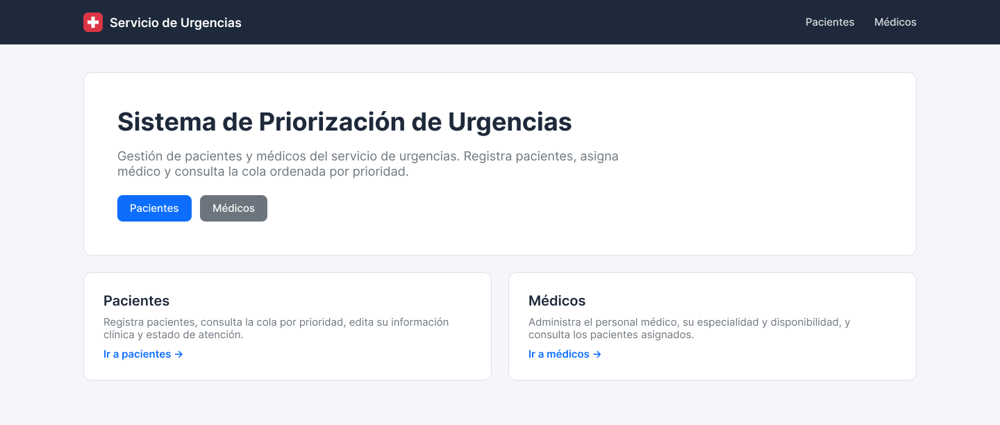
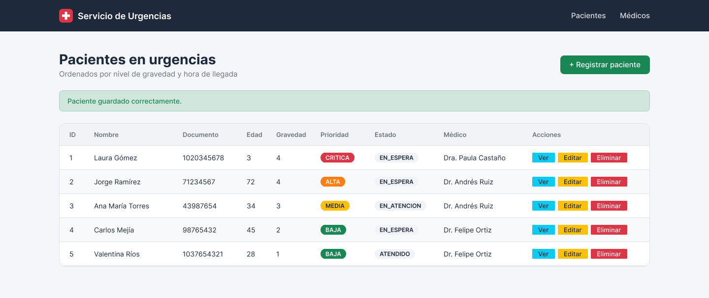
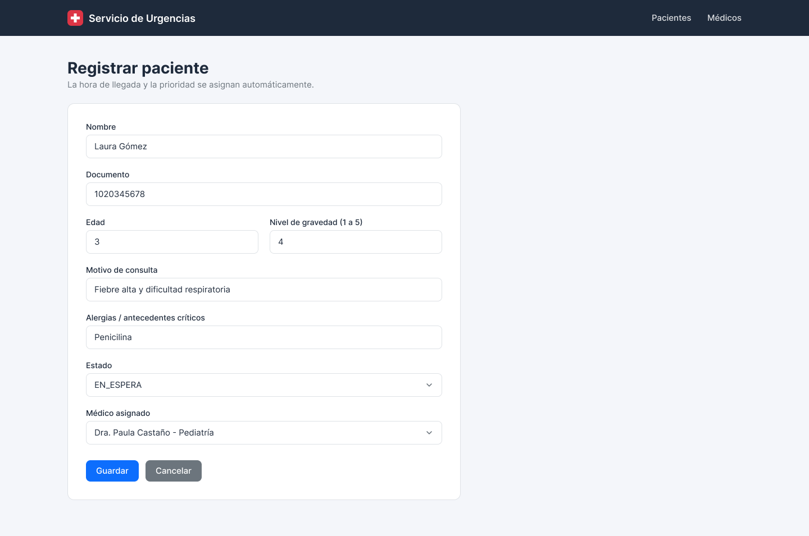
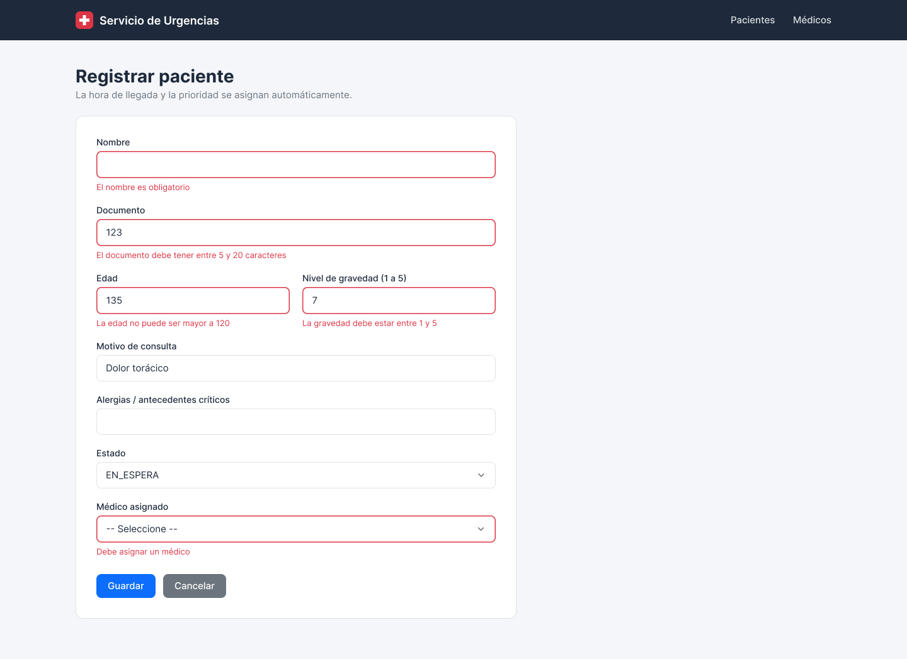
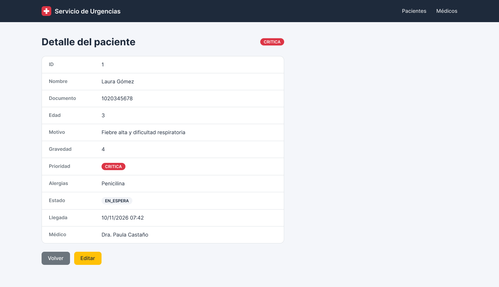
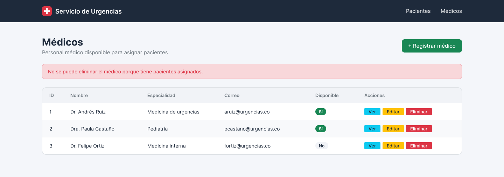
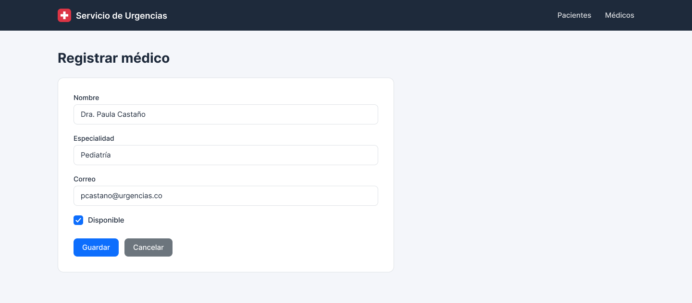
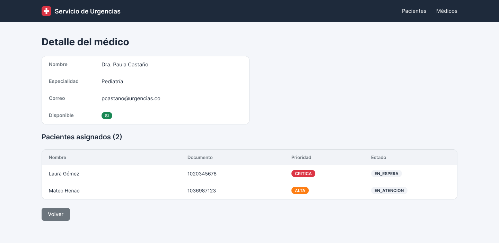

# 08 · Mockups de interfaz

Diseño de las pantallas del sistema en Figma, una por cada vista Thymeleaf de la aplicación MVC.

**Archivo de Figma:** [Urgencias — Mockups del sistema](https://www.figma.com/design/pSPlAJwAQD61afqbqKYwpd)
- Página **Pantallas**: los 8 mockups (escritorio, 1440 px de ancho).
- Página **Componentes**: componentes reutilizables (`Navbar`, `Button`, `Badge`, `Field`) y variables de color.

> Las imágenes de esta carpeta son exportaciones del archivo de Figma. Si se modifica el diseño, se vuelven a exportar y se actualizan en una rama `feature/*`.

## Mapa de pantallas

| # | Pantalla | URL | Plantilla | Controlador | Mockup |
|---|---|---|---|---|---|
| 01 | Inicio | `GET /` | `templates/index.html` | `HomeController` | [01-inicio.png](mockups/01-inicio.png) |
| 02 | Lista de pacientes | `GET /pacientes` | `templates/pacientes/lista.html` | `PacienteController#listar` | [02-pacientes-lista.png](mockups/02-pacientes-lista.png) |
| 03 | Registrar / editar paciente | `GET /pacientes/nuevo`, `GET /pacientes/{id}/editar` | `templates/pacientes/formulario.html` ⚠️ | `PacienteController#nuevo`, `#editar` | [03-pacientes-formulario.png](mockups/03-pacientes-formulario.png) |
| 04 | Formulario de paciente con errores | `POST /pacientes/guardar` (validación fallida) | `templates/pacientes/formulario.html` ⚠️ | `PacienteController#guardar` | [04-pacientes-formulario-errores.png](mockups/04-pacientes-formulario-errores.png) |
| 05 | Detalle de paciente | `GET /pacientes/{id}` | `templates/pacientes/detalle.html` | `PacienteController#ver` | [05-pacientes-detalle.png](mockups/05-pacientes-detalle.png) |
| 06 | Lista de médicos | `GET /medicos` | `templates/medicos/lista.html` | `MedicoController#listar` | [06-medicos-lista.png](mockups/06-medicos-lista.png) |
| 07 | Registrar / editar médico | `GET /medicos/nuevo`, `GET /medicos/{id}/editar` | `templates/medicos/formulario.html` | `MedicoController#nuevo`, `#editar` | [07-medicos-formulario.png](mockups/07-medicos-formulario.png) |
| 08 | Detalle de médico | `GET /medicos/{id}` | `templates/medicos/detalle.html` | `MedicoController#ver` | [08-medicos-detalle.png](mockups/08-medicos-detalle.png) |

⚠️ Hoy el archivo se llama `pacientes/fomulario.html` (le falta la "r"); ver deuda técnica #1 en [07-roadmap.md](07-roadmap.md).

---

### 01 · Inicio
Página de bienvenida con acceso a los dos módulos.

### 02 · Pacientes — Lista
Cola de pacientes ordenada por gravedad y hora de llegada. La prioridad se muestra con color (CRITICA rojo, ALTA naranja, MEDIA amarillo, BAJA verde). Incluye el mensaje de confirmación tras guardar.

### 03 · Pacientes — Formulario
Registro y edición. Campos: nombre, documento, edad, motivo de consulta, nivel de gravedad (1–5), alergias, estado y médico asignado. La hora de llegada y la prioridad las asigna el sistema.

### 04 · Pacientes — Formulario con errores de validación
Estado que se muestra cuando falla `@Valid`: borde rojo y mensaje bajo cada campo inválido.

### 05 · Pacientes — Detalle
Toda la información del paciente, incluida la hora de llegada y el médico asignado.

### 06 · Médicos — Lista
Listado con disponibilidad. Muestra el error cuando se intenta eliminar un médico con pacientes asignados.

### 07 · Médicos — Formulario
Registro y edición: nombre, especialidad, correo y disponibilidad.

### 08 · Médicos — Detalle
Datos del médico y tabla de pacientes asignados (relación uno a muchos).

---

## Guía visual

| Elemento | Valor | Equivalente Bootstrap 5 |
|---|---|---|
| Tipografía | Inter (en la app: fuente del sistema de Bootstrap) | `font-family` por defecto |
| Barra de navegación | `#1E2A3B` | `navbar-dark` con color personalizado |
| Fondo de página | `#F4F6FA` | `bg-light` personalizado |
| Botón principal | `#0D6EFD` | `btn-primary` |
| Botón secundario | `#6C757D` | `btn-secondary` |
| Registrar | `#198754` | `btn-success` |
| Ver / Editar / Eliminar | `#0DCAF0` / `#FFC107` / `#DC3545` | `btn-info` / `btn-warning` / `btn-danger` |
| Prioridad CRITICA / ALTA / MEDIA / BAJA | `#DC3545` / `#FD7E14` / `#FFC107` / `#198754` | `badge` + `bg-danger` / color naranja / `bg-warning` / `bg-success` |
| Tarjetas y tablas | Fondo blanco, borde `#DEE2E6`, radio 12 px | `card`, `table` |

Los datos de los mockups (nombres, documentos, correos) son ficticios.
