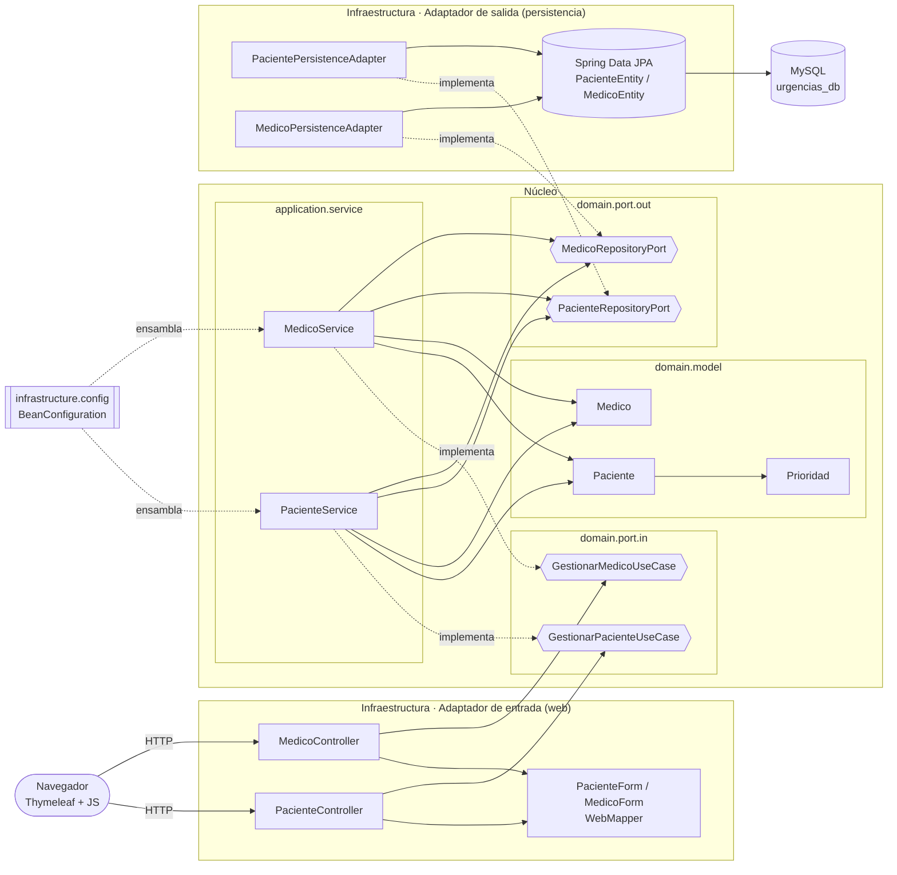
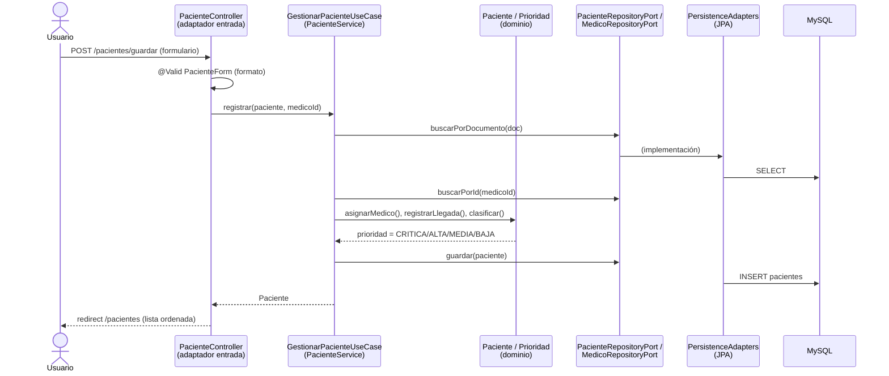

# 10 · Documento técnico: transformación de MVC a Arquitectura Hexagonal

**Asignatura:** Arquitectura de Software · **Tecnología:** Java 21 – Spring Boot 4.1.2 · **Institución:** Institución Universitaria Pascual Bravo

**Equipo:** Samuel López Marín · Wendy Stefania Infante Vera · Karoll Dayanna Moreno Mahecha

---

## 1. Descripción general del proyecto

El **Sistema de Priorización de Atención en Urgencias Médicas** es una aplicación web que registra a los pacientes que llegan al servicio de urgencias, les asigna un médico y calcula automáticamente su **prioridad de atención** (BAJA, MEDIA, ALTA o CRÍTICA) a partir del nivel de gravedad y la edad. La lista de pacientes se muestra ordenada por gravedad y hora de llegada, para que el personal atienda primero los casos más urgentes.

El proyecto se desarrolló primero con el patrón **MVC** (actividad anterior) y en esta actividad se **transformó a Arquitectura Hexagonal** (puertos y adaptadores), conservando toda la funcionalidad:

| Elemento | Detalle |
|---|---|
| Entidades | `Medico` y `Paciente` |
| Relación | Un médico atiende **muchos** pacientes; cada paciente tiene **un** médico obligatorio (`pacientes.medico_id → medicos.id`) |
| Operaciones | CRUD completo de ambas entidades (registrar, consultar/listar, actualizar, eliminar) |
| Reglas de negocio | Cálculo de prioridad, hora de llegada automática, documento único, médico obligatorio, no eliminar un médico con pacientes |
| Interfaz | Web con Thymeleaf + Bootstrap 5 y validación en tiempo real en el navegador |
| Base de datos | MySQL (`urgencias_db`, puerto 3306) mediante Spring Data JPA |

---

## 2. Análisis comparativo: MVC vs. Arquitectura Hexagonal

### 2.1 ¿Cuál es el propósito de cada arquitectura?

- **MVC (Modelo–Vista–Controlador)** busca separar la **presentación** de la **lógica** en aplicaciones con interfaz de usuario. El controlador recibe la petición, el modelo contiene datos y reglas, y la vista muestra el resultado. Su foco es organizar la interacción con el usuario.
- **Arquitectura Hexagonal** (Alistair Cockburn, *Ports and Adapters*) busca **aislar el núcleo de negocio de toda tecnología externa** (web, base de datos, mensajería, APIs). El negocio se comunica con el exterior solo a través de interfaces (puertos) y la tecnología se conecta mediante implementaciones intercambiables (adaptadores). Su foco es proteger y hacer probable el dominio.

### 2.2 ¿Cómo se organizan sus componentes?

- **MVC en Spring Boot** se organiza en capas horizontales apiladas: `controller → service → repository → model`. Cada capa llama a la de abajo, y la base (el modelo) suele ser una entidad JPA ligada a la base de datos.
- **Hexagonal** se organiza en **círculos concéntricos**: en el centro el **dominio** (modelos, reglas y puertos), alrededor la **aplicación** (casos de uso) y en el borde la **infraestructura** (adaptadores de entrada y de salida + configuración). No hay "arriba" ni "abajo": hay **dentro** (negocio) y **fuera** (tecnología).

### 2.3 Responsabilidades en MVC

| Componente | Responsabilidad en nuestro proyecto MVC |
|---|---|
| **Controlador** (`controller/`) | Recibir peticiones HTTP, validar formularios con `@Valid`, llamar al servicio y elegir la vista. En `PacienteController` además verificaba el documento duplicado y buscaba el médico. |
| **Modelo** (`model/`) | Entidades `Paciente` y `Medico` con anotaciones JPA (`@Entity`, `@ManyToOne`) **y** de validación web (`@NotBlank`, `@Size`) en la misma clase. |
| **Servicio** (`service/`) | Reglas de negocio: cálculo de prioridad, hora de llegada, impedir eliminar médicos con pacientes. Dependía directamente de las interfaces de Spring Data. |
| **Repositorio** (`repository/`) | Interfaces `JpaRepository` para acceder a MySQL. |
| **Vista** (`templates/`) | Plantillas Thymeleaf que mostraban directamente las entidades JPA. |

### 2.4 Dominio, puertos y adaptadores en Hexagonal

| Concepto | Qué es | En nuestro proyecto |
|---|---|---|
| **Dominio** | El corazón: modelos y reglas del negocio, en Java puro, sin frameworks | `Paciente`, `Medico`, `Prioridad`, `EstadoPaciente`, excepciones de negocio |
| **Puerto de entrada** (*driving port*) | Interfaz que declara **qué puede hacer** el sistema (casos de uso) | `GestionarPacienteUseCase`, `GestionarMedicoUseCase` |
| **Puerto de salida** (*driven port*) | Interfaz que declara **qué necesita** el dominio del exterior | `PacienteRepositoryPort`, `MedicoRepositoryPort` |
| **Servicio de aplicación** | Implementa los puertos de entrada orquestando dominio y puertos de salida | `PacienteService`, `MedicoService` |
| **Adaptador de entrada** | Traduce un mundo externo (HTTP) a llamadas a los puertos de entrada | Controladores web + formularios (DTO) |
| **Adaptador de salida** | Implementa un puerto de salida con una tecnología concreta | `PacientePersistenceAdapter`, `MedicoPersistenceAdapter` (JPA + MySQL) |

### 2.5 ¿Cómo se gestionan las dependencias?

- **En MVC** las dependencias siguen el flujo de la llamada: el controlador depende del servicio, el servicio depende del repositorio de Spring Data y todos dependen de la entidad JPA. El negocio queda **acoplado a la tecnología de persistencia**.
- **En Hexagonal** se aplica la **regla de dependencia** y el **principio de inversión de dependencias (DIP)**: todas las dependencias apuntan **hacia el dominio**. El servicio de aplicación depende de una *interfaz* (`PacienteRepositoryPort`) definida en el dominio, y es la infraestructura la que la implementa. Spring inyecta la implementación en tiempo de ejecución desde `infrastructure/config/BeanConfiguration`.

```
MVC:        Controller ──▶ Service ──▶ JpaRepository ──▶ Entidad JPA
Hexagonal:  Controller ──▶ UseCase (puerto) ◀── Service ──▶ RepositoryPort (puerto) ◀── PersistenceAdapter
                                       (todas las flechas apuntan al dominio)
```

### 2.6 Ventajas y limitaciones

| | MVC | Hexagonal |
|---|---|---|
| **Ventajas** | Simple y rápido de construir; muy conocido; Spring Boot lo soporta de forma nativa; poco código | Dominio independiente de la tecnología; pruebas unitarias sin BD; cambiar BD o interfaz sin tocar el negocio; reglas centralizadas; dependencias verificables automáticamente |
| **Limitaciones** | Lógica de negocio dispersa entre controlador y servicio; entidades mezclan JPA + validación + vista; difícil probar sin BD; cambiar de tecnología afecta a todo | Más clases e interfaces; mapeos entre DTO ⇄ dominio ⇄ entidad JPA; curva de aprendizaje; puede ser excesiva para un CRUD sencillo |

### 2.7 ¿Cuándo se recomienda MVC?

- Aplicaciones pequeñas o medianas centradas en **CRUD**, con poca lógica de negocio.
- Prototipos, MVP, proyectos académicos introductorios o con plazos muy cortos.
- Sistemas con **una sola interfaz** (web) y **una sola base de datos** que no se espera cambiar.
- Equipos pequeños que necesitan productividad inmediata.

### 2.8 ¿Cuándo se recomienda Hexagonal?

- Sistemas con **reglas de negocio importantes o cambiantes** (como el motor de prioridad clínica de urgencias).
- Aplicaciones que deben exponerse por **varios canales** (web, API REST, app móvil, mensajería) o integrarse con varios sistemas externos.
- Proyectos de **larga vida** donde la tecnología (BD, framework, broker) probablemente cambie.
- Cuando se necesita **alta cobertura de pruebas** y evolución hacia microservicios o eventos.

### 2.9 Tabla comparativa

| Criterio | MVC (versión anterior) | Hexagonal (versión actual) |
|---|---|---|
| Propósito | Separar presentación y lógica | Aislar el negocio de la tecnología |
| Organización | Capas horizontales `controller/service/repository/model` | Núcleo (`domain`, `application`) + borde (`infrastructure`) |
| Centro de la arquitectura | La base de datos (entidad JPA) | El dominio |
| Modelo de negocio | Entidad JPA con `@Entity`, `@NotBlank`, `@OneToMany` | POJO puro sin anotaciones de frameworks |
| Dirección de dependencias | Hacia la persistencia | Hacia el dominio (inversión de dependencias) |
| Acceso a datos desde el servicio | Directo a `JpaRepository` | A través de `PacienteRepositoryPort` / `MedicoRepositoryPort` |
| Qué conoce el controlador | Servicios concretos y entidades JPA | Solo puertos de entrada (casos de uso) y DTO |
| Validación de formato | En la entidad JPA | En el formulario (DTO) del adaptador web |
| Reglas de negocio | Repartidas entre controlador y servicio | En dominio (`Prioridad`, `Paciente.clasificar()`) y casos de uso |
| Pruebas sin base de datos | Difícil (solo existía `contextLoads`) | 19 pruebas unitarias con adaptadores en memoria |
| Cambiar MySQL por otra tecnología | Afecta entidades, repositorios y servicios | Solo se reemplaza el adaptador de persistencia |
| Agregar una API REST | Duplicar lógica o acoplar al servicio | Nuevo adaptador de entrada que reutiliza los mismos casos de uso |
| Número de clases Java | 11 | 29 |
| Complejidad inicial | Baja | Media |
| Verificación de la arquitectura | Manual | Automática con ArchUnit en cada build |

### 2.10 Conclusión del análisis

MVC y Hexagonal no resuelven el mismo problema: **MVC organiza la interacción con el usuario**, mientras que **Hexagonal protege el negocio de la tecnología**. En la versión MVC del proyecto la regla de prioridad, la validación del documento y la búsqueda del médico estaban repartidas entre el controlador y el servicio, y todo dependía de las entidades JPA; cualquier cambio de base de datos o de canal habría obligado a tocar el negocio. Para un sistema de urgencias, cuyo valor está precisamente en las reglas clínicas y que en el futuro necesita tiempo real, API y posibles cambios de infraestructura (ver [ADR-0002](adr/0002-hexagonal-con-eventos-como-objetivo.md)), Hexagonal es la opción más adecuada, aceptando el costo de más clases y mapeos. MVC sigue siendo la mejor opción para CRUDs simples y de corta vida.

---

## 3. Estructura de paquetes de la Arquitectura Hexagonal

Se siguió la estructura de referencia de la actividad, dentro del paquete base del proyecto (`com.pascualbravo.urgencias`):

```
src/main/java/com/pascualbravo/urgencias/
│
├── UrgenciasApplication.java                 # Arranque de Spring Boot
│
├── domain/                                   # ── NÚCLEO: Java puro, sin Spring ni JPA ──
│   ├── model/
│   │   ├── Paciente.java                     # Reglas: médico obligatorio, rangos, clasificar()
│   │   ├── Medico.java                       # actualizarDatos()
│   │   ├── Prioridad.java                    # enum + regla de cálculo de prioridad (RF02)
│   │   └── EstadoPaciente.java
│   ├── exception/
│   │   ├── ReglaNegocioException.java
│   │   ├── DocumentoDuplicadoException.java
│   │   └── RecursoNoEncontradoException.java
│   └── port/
│       ├── in/                               # Puertos de ENTRADA (casos de uso)
│       │   ├── GestionarPacienteUseCase.java
│       │   └── GestionarMedicoUseCase.java
│       └── out/                              # Puertos de SALIDA (lo que el dominio necesita)
│           ├── PacienteRepositoryPort.java
│           └── MedicoRepositoryPort.java
│
├── application/
│   └── service/                              # Implementación de los casos de uso (sin Spring)
│       ├── PacienteService.java
│       └── MedicoService.java
│
└── infrastructure/                           # ── BORDE: tecnología ──
    ├── adapter/
    │   ├── in/
    │   │   └── web/                          # Adaptador de ENTRADA: HTTP + Thymeleaf
    │   │       ├── HomeController.java
    │   │       ├── PacienteController.java
    │   │       ├── MedicoController.java
    │   │       ├── WebExceptionHandler.java
    │   │       ├── dto/       (PacienteForm, MedicoForm)
    │   │       └── mapper/    (WebMapper)
    │   └── out/
    │       └── persistence/                  # Adaptador de SALIDA: JPA + MySQL
    │           ├── PacientePersistenceAdapter.java
    │           ├── MedicoPersistenceAdapter.java
    │           ├── entity/     (PacienteEntity, MedicoEntity)
    │           ├── repository/ (SpringDataPacienteRepository, SpringDataMedicoRepository)
    │           └── mapper/     (PersistenceMapper)
    └── config/
        └── BeanConfiguration.java            # Conecta casos de uso con adaptadores

src/main/resources/
├── application.properties                    # Conexión a MySQL
├── messages.properties
├── templates/                                # Vistas Thymeleaf (se conservan)
│   ├── index.html, fragments/layout.html
│   ├── pacientes/ (lista, formulario, detalle)
│   ├── medicos/   (lista, formulario, detalle)
│   └── error/no-encontrado.html
└── static/js/validacion-formularios.js
```

---

## 4. Responsabilidad de cada componente

### 4.1 Paquete por paquete

| Paquete | Responsabilidad | Puede depender de | No puede depender de |
|---|---|---|---|
| `domain.model` | Representar los conceptos del negocio y sus reglas internas | Solo Java estándar y `domain.exception` | Spring, JPA, Jakarta, `application`, `infrastructure` |
| `domain.exception` | Expresar violaciones de reglas de negocio con nombres del dominio | Java estándar | Todo lo demás |
| `domain.port.in` | Declarar los casos de uso que el sistema ofrece al exterior | `domain.model` | Tecnología |
| `domain.port.out` | Declarar lo que el negocio necesita del exterior (persistencia) | `domain.model` | Tecnología |
| `application.service` | Orquestar cada caso de uso: validar reglas que requieren consultar datos, resolver relaciones y delegar en el dominio | `domain` | `infrastructure`, Spring, Jakarta |
| `infrastructure.adapter.in.web` | Traducir HTTP ⇄ casos de uso: rutas, validación de formato, selección de vistas, mensajes | `domain` (puertos de entrada, modelos, excepciones) | `adapter.out`, `application.service` |
| `infrastructure.adapter.out.persistence` | Implementar los puertos de salida con JPA/MySQL y traducir dominio ⇄ entidad | `domain` (puertos de salida, modelos) | `adapter.in` |
| `infrastructure.config` | Ensamblar el hexágono: crear los servicios e inyectarles los adaptadores | Todo | — |

### 4.2 Clase por clase

| Componente | Capa | Responsabilidad |
|---|---|---|
| `Paciente` | Dominio | Datos del paciente; `asignarMedico()` exige médico; `clasificar()` valida edad (0–120) y gravedad (1–5) y calcula la prioridad; `registrarLlegada()` |
| `Medico` | Dominio | Datos del médico; `actualizarDatos()` copia los campos editables |
| `Prioridad` | Dominio | Enum `BAJA/MEDIA/ALTA/CRITICA` y regla `calcular(gravedad, edad)`: gravedad + 1 punto si ≤ 5 o ≥ 70 años |
| `EstadoPaciente` | Dominio | `EN_ESPERA`, `EN_ATENCION`, `ATENDIDO` |
| `ReglaNegocioException`, `DocumentoDuplicadoException`, `RecursoNoEncontradoException` | Dominio | Errores con significado de negocio, independientes de HTTP |
| `GestionarPacienteUseCase` | Puerto de entrada | `registrar`, `listarPorPrioridad`, `buscarPorId`, `listarPorMedico`, `actualizar`, `eliminar` |
| `GestionarMedicoUseCase` | Puerto de entrada | `registrar`, `listar`, `buscarPorId`, `actualizar`, `eliminar` |
| `PacienteRepositoryPort` | Puerto de salida | `guardar`, `buscarPorId`, `buscarPorDocumento`, `listarOrdenadosPorGravedadYLlegada`, `listarPorMedico`, `existenPacientesDelMedico`, `eliminarPorId` |
| `MedicoRepositoryPort` | Puerto de salida | `guardar`, `buscarPorId`, `listarTodos`, `eliminarPorId` |
| `PacienteService` | Aplicación | Documento único, resolver médico por id, hora de llegada (con `Clock` para poder probarla), conservar llegada al editar, delegar clasificación al dominio |
| `MedicoService` | Aplicación | CRUD de médicos; impide eliminar un médico con pacientes |
| `PacienteController`, `MedicoController`, `HomeController` | Adaptador de entrada | Rutas `/pacientes`, `/medicos`, `/`; `@Valid` sobre DTO; traducen excepciones de negocio a mensajes en el formulario |
| `PacienteForm`, `MedicoForm` | Adaptador de entrada | Datos del formulario con Bean Validation (mismos mensajes de [09](09-reglas-de-campos.md)); el médico viaja como `medicoId` |
| `WebMapper` | Adaptador de entrada | Formulario ⇄ dominio |
| `WebExceptionHandler` | Adaptador de entrada | `RecursoNoEncontradoException` → página 404 amigable |
| `PacientePersistenceAdapter`, `MedicoPersistenceAdapter` | Adaptador de salida | Implementan los puertos de salida con Spring Data JPA; manejan transacciones (`@Transactional`) |
| `PacienteEntity`, `MedicoEntity` | Adaptador de salida | Mapeo JPA a las tablas `pacientes` y `medicos` (mismas columnas que en MVC) |
| `SpringDataPacienteRepository`, `SpringDataMedicoRepository` | Adaptador de salida | Consultas derivadas de Spring Data (detalle interno del adaptador) |
| `PersistenceMapper` | Adaptador de salida | Dominio ⇄ entidad JPA |
| `BeanConfiguration` | Configuración | Declara `PacienteService` y `MedicoService` como beans e inyecta los adaptadores |
| Plantillas Thymeleaf | Vista (adaptador web) | Presentación; sin lógica de negocio |

---

## 5. Diagrama de arquitectura



**Lectura del diagrama:** las flechas continuas son "usa"; las punteadas, "implementa". Los controladores solo conocen los puertos de entrada; los servicios solo conocen el dominio y los puertos de salida; los adaptadores de persistencia implementan esos puertos. **Ninguna flecha sale del núcleo hacia la infraestructura.**

### 5.1 Flujo: registrar un paciente



---

## 6. Verificación del funcionamiento

La transformación **no cambió** las URL, las pantallas ni las tablas de la base de datos (`medicos`, `pacientes` con `medico_id`), por lo que una base de datos creada con la versión MVC sigue funcionando.

| Requisito de la actividad | Cómo se verifica |
|---|---|
| Registrar, consultar, listar, actualizar y eliminar **médicos** | `CrudHexagonalIntegrationTest` + prueba manual en `/medicos` |
| Registrar, consultar, listar, actualizar y eliminar **pacientes** | `CrudHexagonalIntegrationTest` + prueba manual en `/pacientes` |
| Mantener la relación entre las entidades | Paciente guardado con `medico_id`; detalle del médico lista sus pacientes; no se elimina un médico con pacientes |
| Interfaz gráfica web | Las mismas 8 pantallas Thymeleaf (ver [08-mockups](08-mockups.md)) |
| Persistencia en base de datos | Adaptadores JPA sobre MySQL (en pruebas, H2 en memoria con modo MySQL) |
| Controladores sin acceso a repositorios | Regla automática en `ArquitecturaHexagonalTest` |
| Servicios que usan los puertos | Los servicios solo reciben `PacienteRepositoryPort` / `MedicoRepositoryPort` en su constructor |

### 6.1 Pruebas automáticas

| Prueba | Tipo | Qué demuestra |
|---|---|---|
| `PrioridadTest` (5) | Unitaria de dominio | La regla de prioridad funciona sin Spring ni BD |
| `PacienteTest` (4) | Unitaria de dominio | Rangos de edad/gravedad y médico obligatorio |
| `PacienteServiceTest` (6) | Unitaria de aplicación | Casos de uso con **adaptadores en memoria** (`RepositoriosEnMemoria`): prueba directa de que los puertos desacoplan el negocio de MySQL |
| `MedicoServiceTest` (4) | Unitaria de aplicación | CRUD y regla "no eliminar médico con pacientes" |
| `CrudHexagonalIntegrationTest` | Integración de punta a punta | HTTP simulado → controladores → casos de uso → JPA → H2: CRUD de ambas entidades, relación, validaciones, documento duplicado y página 404 |
| `ArquitecturaHexagonalTest` (4 reglas) | Arquitectura (ArchUnit) | El dominio no depende de Spring/JPA/infraestructura; la aplicación no depende de infraestructura; los controladores no usan persistencia ni servicios concretos |
| `UrgenciasApplicationTests` | Arranque | El contexto de Spring levanta y ensambla el hexágono |

Ejecutar todas: `./mvnw clean verify` (Windows: `mvnw.cmd clean verify`). No requieren MySQL.

---

## 7. Reflexión arquitectónica

### 7.1 ¿Qué cambios importantes se realizaron al pasar de MVC a Arquitectura Hexagonal?

1. **Se separó el modelo de dominio de la entidad JPA.** En MVC `Paciente` tenía a la vez `@Entity`, `@ManyToOne` y `@NotBlank`. Ahora hay tres representaciones con una sola responsabilidad cada una: `domain.model.Paciente` (negocio, Java puro), `PacienteEntity` (tabla) y `PacienteForm` (formulario).
2. **Se crearon puertos**: dos de entrada (casos de uso) y dos de salida (repositorios). Los controladores dependen de los primeros y los servicios de los segundos.
3. **Se invirtió la dependencia de persistencia**: los servicios ya no usan `JpaRepository`; usan `PacienteRepositoryPort`, y `PacientePersistenceAdapter` lo implementa.
4. **Se movió la lógica de negocio que estaba en el controlador**: la verificación de documento duplicado y la búsqueda del médico pasaron de `PacienteController` a `PacienteService`; la regla de prioridad pasó del servicio al dominio (`Prioridad.calcular`, `Paciente.clasificar`).
5. **La prioridad dejó de ser un `String` libre** y ahora es el enum `Prioridad` (resuelve la deuda técnica #3 del [roadmap](07-roadmap.md)).
6. **Los servicios ya no son `@Service`**: no tienen anotaciones de Spring y se registran como beans en `BeanConfiguration`, para que la capa de aplicación no dependa del framework.
7. **Se agregó manejo de excepciones de negocio** (`ReglaNegocioException`, `DocumentoDuplicadoException`, `RecursoNoEncontradoException`) y una página 404 en vez del error 500 cuando un id no existe.
8. **Se agregaron pruebas** unitarias, de integración y de arquitectura (antes solo existía `contextLoads`).

### 7.2 ¿Qué componentes del proyecto MVC se conservaron y cuáles tuvieron que reorganizarse?

| Se conservaron (sin cambios o con cambios mínimos) | Se reorganizaron |
|---|---|
| Las 8 plantillas Thymeleaf, el layout y `validacion-formularios.js` (solo cambió `medico.id` → `medicoId` en el formulario de paciente y la fuente de la lista de pacientes en el detalle del médico) | `model/Paciente`, `model/Medico` → divididos en modelo de dominio + entidad JPA + formulario DTO |
| Las URL y rutas (`/pacientes`, `/medicos`, …) | `service/*Service` → `application/service`, implementando puertos de entrada y sin `@Service` |
| La base de datos, tablas y columnas | `repository/*Repository` → `infrastructure/adapter/out/persistence/repository`, ocultos detrás de los adaptadores |
| `application.properties`, `messages.properties`, `pom.xml` (se agregaron solo dependencias de prueba) | `controller/*` → `infrastructure/adapter/in/web`, dependiendo solo de casos de uso |
| Mensajes y reglas de validación de cada campo | `EstadoPaciente` → `domain/model` |
| La regla de cálculo de prioridad (mismo resultado) | Cálculo de prioridad → del servicio al dominio |

### 7.3 ¿Cómo se evidencia el bajo acoplamiento en la nueva implementación?

- Los controladores reciben **interfaces** (`GestionarPacienteUseCase`), no clases concretas: se podría reemplazar `PacienteService` sin tocar la web.
- Los servicios reciben **interfaces** (`PacienteRepositoryPort`): en las pruebas se les pasan implementaciones en memoria (`RepositoriosEnMemoria`) y funcionan igual que con MySQL. Esa es la evidencia más concreta del desacoplamiento.
- El dominio compila **sin ninguna librería externa** (ni Spring, ni JPA, ni Jakarta Validation).
- Las entidades JPA y los DTO web no se conocen entre sí; cada adaptador traduce con su propio mapper.
- `ArquitecturaHexagonalTest` falla el build si alguien introduce un acoplamiento prohibido (p. ej. un controlador que importe un repositorio).

### 7.4 ¿Cómo se evidencia la alta cohesión en la distribución de responsabilidades?

Cada clase tiene **un solo motivo para cambiar**:

| Si cambia… | Se modifica solo… |
|---|---|
| La regla clínica de prioridad | `Prioridad` (dominio) |
| Un mensaje o límite de un campo del formulario | `PacienteForm` / `MedicoForm` + plantilla |
| El nombre de una columna o tabla | `PacienteEntity` / `MedicoEntity` |
| Una consulta SQL | `SpringData*Repository` / adaptador de persistencia |
| Una ruta o una pantalla | Controlador / plantilla |
| Qué implementación se usa para un puerto | `BeanConfiguration` |

Los paquetes agrupan elementos que cambian juntos: todo lo de JPA está en `adapter/out/persistence`, todo lo de HTTP en `adapter/in/web` y todas las reglas en `domain`.

### 7.5 ¿Qué ventajas ofrece la Arquitectura Hexagonal frente a MVC para este proyecto?

- **Reglas clínicas protegidas y probadas**: el motor de prioridad es el corazón del sistema y ahora se prueba en milisegundos, sin base de datos. La fase 3 del roadmap (reglas de edad, gravedad, signos vitales y tiempo de espera como estrategias) se puede agregar dentro del dominio sin tocar la web ni JPA.
- **Nuevos canales sin duplicar lógica**: la cola en tiempo real (WebSocket), una API REST para tablets o un tablero de turnos serían nuevos adaptadores de entrada que reutilizan los mismos casos de uso.
- **Preparado para la arquitectura objetivo** ([ADR-0002](adr/0002-hexagonal-con-eventos-como-objetivo.md)): publicar eventos (RabbitMQ) será un nuevo puerto de salida.
- **Cambio de tecnología acotado**: migrar de MySQL a PostgreSQL o a otra persistencia afecta solo al adaptador.
- **Calidad verificable**: las reglas de dependencia se comprueban automáticamente.

### 7.6 ¿En qué escenario sería preferible conservar MVC en lugar de implementar Arquitectura Hexagonal?

Si el sistema fuera **solo un registro CRUD** de pacientes y médicos, sin reglas clínicas relevantes, con una única interfaz web, una única base de datos que no se piensa cambiar, una vida corta (por ejemplo, un prototipo para una feria o una entrega de una sola actividad) y un equipo pequeño con poco tiempo, **MVC sería preferible**: entrega el mismo resultado con casi la mitad de clases y sin mapeos. Hexagonal solo compensa su costo cuando hay negocio que proteger o tecnología que pueda cambiar.

### 7.7 Si en el futuro se cambia la base de datos o la tecnología de persistencia, ¿qué partes del proyecto deberían modificarse y por qué?

| Cambio | Qué se modifica | Qué NO se modifica |
|---|---|---|
| MySQL → PostgreSQL (seguir con JPA) | Solo `application.properties` y la dependencia del driver en `pom.xml` | Todo el código Java |
| JPA → JDBC, MongoDB, un servicio REST externo, etc. | Se crea un nuevo adaptador en `infrastructure/adapter/out/<tecnologia>/` que implemente `PacienteRepositoryPort` y `MedicoRepositoryPort`, con sus propias entidades/documentos y mapper; se elimina o desactiva el adaptador JPA; se ajusta `pom.xml` | `domain`, `application`, controladores, DTO y plantillas |

**¿Por qué?** Porque el dominio y los casos de uso dependen únicamente de las **interfaces** de los puertos de salida, no de su implementación. Mientras el nuevo adaptador cumpla el contrato del puerto, el núcleo no se entera del cambio. Las pruebas `PacienteServiceTest` y `MedicoServiceTest` ya demuestran esto: ejecutan los casos de uso con un "adaptador" en memoria en lugar de MySQL.

---

## 8. Conclusiones sobre la transformación realizada

1. La transformación fue **real, no solo de nombres de carpetas**: se dividieron las entidades en tres modelos con responsabilidades distintas, se introdujeron cuatro puertos, se invirtió la dependencia de persistencia y se movió lógica de negocio del controlador al servicio y al dominio.
2. **La funcionalidad se conservó**: mismas URL, pantallas, validaciones, reglas de prioridad y tablas; el CRUD de médicos y pacientes y su relación se verifican con una prueba de integración de punta a punta.
3. Los principios de la actividad quedaron **evidenciados en el código**: separación de responsabilidades (paquetes por rol), bajo acoplamiento (interfaces + adaptadores en memoria), alta cohesión (un motivo de cambio por clase) e inversión de dependencias (los servicios dependen de puertos definidos en el dominio).
4. El costo fue **más clases (de 11 a 29) y mapeos** entre DTO, dominio y entidades. Para este proyecto el costo se justifica porque las reglas clínicas son el núcleo del valor y el roadmap incluye tiempo real, seguridad, reportes y eventos.
5. Como trabajo futuro, el motor de prioridad puede convertirse en estrategias dentro de `domain` (fase 3) y la cola en tiempo real en un nuevo adaptador de entrada/salida (fase 5), sin rehacer lo construido.
